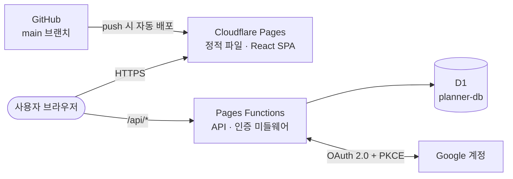

<div align="center">

# 📅 플래너

**캘린더 · 할 일 · 타임 블록 · 통계를 한 곳에서 관리하는 일정 관리 웹 서비스**

[**🔗 사이트 바로가기**](https://my-planner-e39.pages.dev)


<br>


</div>

Google 계정으로 로그인해 사용하며, 데이터는 사용자별로 분리되어 저장됩니다.

## 🛠 기술 스택

| 영역 | 기술 | 설명 |
|---|---|---|
| **Frontend** | React, TypeScript | 컴포넌트 기반 SPA |
| | Vite | 개발 서버 · 번들링 |
| | Tailwind CSS v4 | 유틸리티 기반 스타일링 |
| | React Router | 클라이언트 라우팅 |
| | date-fns | 날짜 계산 · 한국어 포맷 |
| **Backend** | Cloudflare Pages Functions | 서버리스 API (`/api/*`), 엣지에서 실행 |
| | Cloudflare D1 | SQLite 기반 서버리스 DB (운영 / 미리보기 분리) |
| **Auth** | Google OAuth 2.0 · OpenID Connect | 라이브러리 없이 직접 구현 (PKCE + state) |
| | 세션 쿠키 | 해시 저장 토큰, `__Host-` · `HttpOnly` · `Secure` |
| **Infra / CI** | GitHub → Cloudflare Pages | `main` push 시 자동 빌드 · 배포 |
| | Wrangler | 로컬 개발 · DB 마이그레이션 · 시크릿 관리 |
| | Dependabot · Secret scanning | 의존성 업데이트 · 비밀값 유출 차단 |

> 차트는 별도 라이브러리 없이 직접 구현했고, 상태 관리는 React 기본 훅만 사용합니다.

### 아키텍처



## ✨ 기능

- **캘린더**: 월간 보기, 종일·여러 날 일정, 색상, 날짜별 일정 · 할 일 패널 (바로 완료 · 추가)
- **할 일**: 빠른 추가, 마감일·우선순위, 기한별 그룹, 필터
- **타임 블록**: 드래그로 시간 블록 생성(15분 단위), 카테고리, 할 일 연결, 겹침 배치
- **통계**: 기간별 완료 수, 마감 달성률, 계획 시간, 카테고리별 시간
- **계정**: 데이터 내보내기(JSON), 회원 탈퇴(즉시 전체 삭제)
- **공통**: 삭제 시 확인 모달, 모바일 하단 탭 지원

## 📁 구조

```
src/                      프론트엔드 (React)
  pages/                  화면별 컴포넌트 (+ 개인정보처리방침/약관)
  lib/site.ts             운영자 정보 (방침/약관에 표시)
functions/                Cloudflare Pages Functions (= /api/*)
  api/_middleware.ts      Origin 검사(CSRF) + 로그인 확인 + 보안 헤더
  api/auth/               Google OAuth (PKCE)
  api/events, tasks, blocks, stats, me, export
  _lib/                   공통 코드 (검증, CRUD, 세션)
migrations/               D1 스키마
public/_headers           정적 파일 보안 헤더 (CSP 등)
```

날짜·시간은 사용자 로컬 기준 문자열(`YYYY-MM-DD`, `YYYY-MM-DDTHH:mm`)로 저장합니다.

## 💻 로컬 개발

1. Google Cloud Console에서 OAuth 클라이언트(웹 애플리케이션)를 만들고, 리디렉션 URI에
   `http://localhost:5173/api/auth/callback`을 추가합니다.
2. 설정:

   ```bash
   npm install
   cp .dev.vars.example .dev.vars        # GOOGLE_CLIENT_ID / GOOGLE_CLIENT_SECRET 입력
   npm run db:migrate:local
   npm run build                         # 최초 1회 (wrangler가 dist 필요)
   ```

3. 터미널 두 개에서 실행:

   ```bash
   npm run dev:api    # wrangler: API + 로컬 D1 (localhost:8788)
   npm run dev        # vite: 프론트 (localhost:5173), /api는 8788로 프록시
   ```

## 🚀 배포 (Cloudflare Pages)

`main` 브랜치에 push하면 Cloudflare Pages가 자동으로 빌드·배포합니다.

- Build command: `npm run build` / Output: `dist`
- D1 바인딩 `DB`는 `wrangler.toml`에서 적용
- 환경 변수(Secrets): `GOOGLE_CLIENT_ID`, `GOOGLE_CLIENT_SECRET`
  - 선택: `ALLOWED_EMAILS` (쉼표 구분) — 설정하면 해당 이메일만 로그인 허용
- 미리보기 배포(`main` 이외 브랜치)는 운영 DB가 아닌 `planner-db-preview`를 사용 (`wrangler.toml`의 `[env.preview]`)
- 스키마 변경: `migrations/000N_xxx.sql` 추가 후 `npm run db:migrate:remote` **와** `npm run db:migrate:preview`

## 🔒 보안

[SECURITY.md](SECURITY.md) 참고. 취약점은 공개 이슈 대신 Security 탭의 비공개 신고를 이용해 주세요.

## 📡 API

`/api/auth/*`를 제외한 모든 요청은 세션 쿠키가 필요하며, 상태 변경 요청은 같은 출처(Origin)에서만 허용됩니다.

| Method | Path | 설명 |
|---|---|---|
| GET / DELETE | `/api/me` | 로그인 사용자 / 회원 탈퇴 (`{"confirm": "<이메일>"}`) |
| GET | `/api/export` | 내 데이터 전체 JSON |
| GET/POST | `/api/events?from&to` | 기간과 겹치는 일정 / 생성 |
| PATCH/DELETE | `/api/events/:id` | 수정 / 삭제 |
| GET/POST | `/api/tasks` | 전체 할 일 / 생성 |
| PATCH/DELETE | `/api/tasks/:id` | 수정 (완료 시 `completed_at` 필요) / 삭제 |
| GET/POST | `/api/blocks?from&to` | 타임 블록 / 생성 |
| PATCH/DELETE | `/api/blocks/:id` | 수정 / 삭제 |
| GET | `/api/stats?from&to&today` | 통계 집계 |
