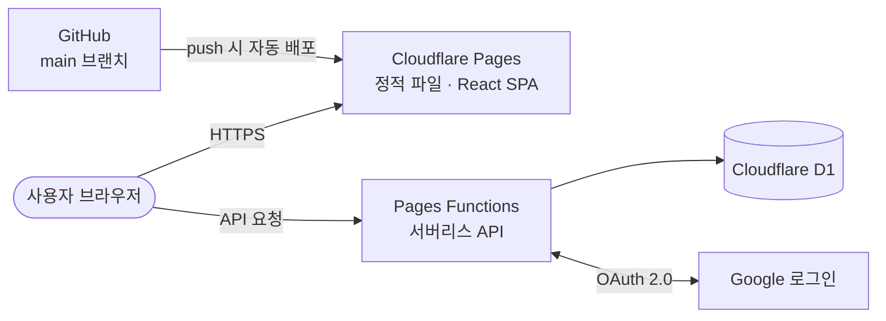

# 🐾 Dailumi (데일루미)

**동물 친구와 함께하는 게임형 플래너** 
캘린더 · 할 일 · 타임 블록 · 통계를 한 곳에서 관리하세요

 

일정, 해야 할 일, 하루 시간 계획을 따로따로 관리하느라 번거로웠다면 — Dailumi에서 한 번에 정리하세요.
Google 계정으로 로그인하면 바로 시작할 수 있고, PC와 모바일 어디서든 같은 데이터를 볼 수 있습니다.

## ✨ 주요 기능

### 🏠 대시보드
- 오늘의 할 일, 오늘의 일정, 이번 달 캘린더를 **한 화면에서** 확인
- **이번 주 진행률**과 **연속 달성** 기록으로 꾸준함을 한눈에
- 나의 동물 친구 — 수집 · 꾸미기 기능은 **준비 중**이에요

### 🎁 일일 접속 보상
- 하루의 **첫 접속**에 고양이가 선물을 가져와요 (한국 시간 기준 하루 1번)
- 코인과 함께 **랜덤 액세서리**(일반 · 레어 · 슈퍼 레어 · 스페셜)를 받을 수 있어요
- 이미 가진 액세서리가 나오면 대신 **추가 코인**을 받아요

### 🌗 테마와 다크 모드
- 웜 뉴트럴 · 숲 · 하늘 · 라벤더 · 복숭아 · 모노 중 원하는 **테마 색**
- 전등 줄을 당겨서 켜는 **다크 모드**

### 📆 캘린더
- 한 달 일정을 한눈에 보는 **월간 달력**
- 시간 일정, **종일 일정**, **여러 날에 걸친 일정** 지원
- 일정마다 **색상**을 골라 구분
- 날짜를 누르면 그날의 **일정과 할 일**을 함께 확인
- 그 자리에서 할 일을 **체크해 완료**하거나 **새로 추가**

### ✅ 할 일
- 입력창에 적고 엔터만 누르면 되는 **빠른 추가**
- **마감일**과 **우선순위**(낮음 · 보통 · 높음) 설정
- **기한 지남 · 오늘 · 내일 · 예정 · 기한 없음**으로 자동 분류
- 진행 중 · 오늘 · 완료 · 전체 **필터**

### ⏱ 타임 블록
- 하루 시간표에서 **드래그해서 시간 블록**을 만드는 시간 계획 도구 (15분 단위)
- 업무 · 공부 · 운동 · 개인 · 미팅 · 휴식 **카테고리**별 색상
- 할 일을 눌러 **할 일과 연결된 블록**을 바로 생성
- 현재 시각 표시와 카테고리별 **하루 시간 합계**

### 📊 통계
- 최근 **7일 · 30일 · 90일** 기간 선택
- 완료한 할 일 수, **마감 달성률**, 계획한 시간, 남은 할 일
- 날짜별 완료 수 · 계획 시간 **막대 차트**
- **카테고리별** 시간 사용 비율

### 👤 계정과 데이터
- **Google 계정**으로 간편 로그인 — 별도 회원가입 없음
- 내 데이터는 나만 볼 수 있도록 **사용자별로 분리** 저장
- 언제든 **내 데이터 내려받기**(JSON) 가능
- **회원 탈퇴** 시 모든 데이터 즉시 삭제
- 삭제 전에는 항상 **확인 창**으로 한 번 더 확인

### 📱 어디서나
- PC에서는 사이드바, 모바일에서는 **하단 탭**으로 편하게 이동

## 🛠 기술 스택

| 영역 | 기술 | 설명 |
|---|---|---|
| **Frontend** | React, TypeScript | 컴포넌트 기반 SPA |
| | Vite | 개발 서버 · 번들링 |
| | Tailwind CSS v4 | 유틸리티 기반 스타일링 |
| | React Router | 클라이언트 라우팅 |
| | date-fns | 날짜 계산 · 한국어 포맷 |
| **Backend** | Cloudflare Pages Functions | 서버리스 API, 엣지에서 실행 |
| | Cloudflare D1 | SQLite 기반 서버리스 DB |
| **Auth** | Google OAuth 2.0 · OpenID Connect | Google 계정 로그인 |
| **Infra / CI** | GitHub → Cloudflare Pages | `main` push 시 자동 빌드 · 배포 |
| | Dependabot | 의존성 자동 업데이트 |

> 차트는 별도 라이브러리 없이 직접 구현했고, 상태 관리는 React 기본 훅만 사용합니다.

### 아키텍처

